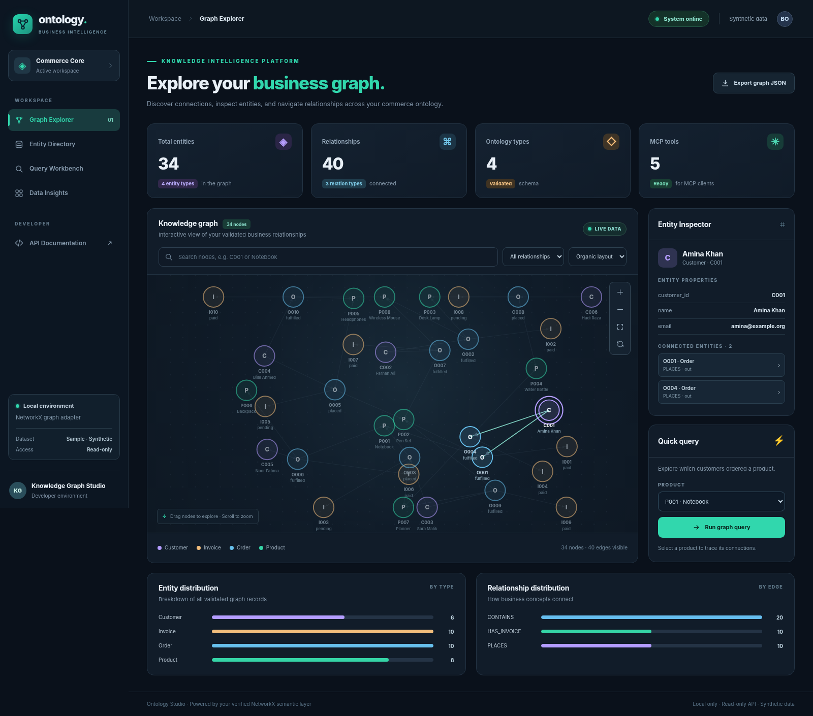

# business-ontology-mcp

Open-source business ontology semantic layer with knowledge graph adapters and MCP integration for AI agents.

# Business Ontology MCP

An open-source Python semantic layer for defining
business concepts, building knowledge graphs, and
exposing graph queries to AI agents through MCP.

## Planned Components

- YAML ontology definitions
- Pydantic schema validation
- NetworkX graph prototype
- Omnigraph graph adapter
- MCP tools and resources
- Automated tests

## Architecture

See [Architecture Design](docs/architecture.md).

## References

- https://github.com/ModernRelay/omnigraph
- https://github.com/NVIDIA/auto-ontology

## Status

ONT-01: Architecture and reference analysis.
Implementation begins in ONT-02.

# ONT-02

## Business Ontology Schema

The initial ontology is defined in
`ontology/business.yaml`.

It contains four entity types:

- Customer
- Product
- Order
- Invoice

Relationships:

- Customer PLACES Order
- Order CONTAINS Product
- Order HAS_INVOICE Invoice

It also declares a paid-invoice amount metric
grouped by currency.

### Installation

Create and activate a Python virtual environment,
then run:

    python -m pip install -r requirements.txt

### Load the ontology

    python -m src.schema

### Run tests

    python -m pytest -v

### Current scope

ONT-02 provides typed ontology definitions,
YAML loading, structural validation and
basic reference checking.

Full business-record validation and graph
construction are implemented in later tasks.

# ONT-03

## Business Record Validation

The ontology validator checks business records
and relationships against the declared schema.

Supported checks:

- Required and unknown properties
- Property data types
- Unique entity identifiers
- Referential integrity
- Relationship cardinality
- Duplicate relationships

### Run demonstration

python check_validation.py

### Test invalid data

python check_validation.py --invalid

### Run automated tests

python -m pytest -v

For implementation details, see:
docs/ont03-record-validation.md

# ONT-04

## Synthetic Business Dataset

The project includes a reproducible synthetic
commerce dataset in `sample_data/`.

It contains:

- 6 customers
- 8 products
- 10 orders
- 10 invoices
- 40 relationships

All records are fictional.

### Load and validate

python load_sample_data.py

### Run tests

python -m pytest -v

The CSV loader uses ontology-defined property types
and the ONT-03 record validator.

See docs/ont04-sample-data.md for dataset details.

Graph construction will be implemented in ONT-05.

# ONT-05

## Knowledge Graph Adapter

ONT-05 adds a validated, typed knowledge graph
using NetworkX.

### Build and query the graph

python build_graph.py

### Export for Omnigraph

python export_omnigraph.py

### Run tests

python -m pytest -v

The NetworkX adapter supports entity lookup and
directed relationship traversal.

An Omnigraph schema and JSONL export bridge is
provided. Live Omnigraph loading still requires
verification against a compatible CLI.

See docs/ont05-graph-adapter.md for details.

# ONT-08

## End-to-End Integration and Reliability

ONT-08 verifies the complete synthetic business
data pipeline:

CSV -> Ontology Validation -> NetworkX Graph
-> Semantic Service -> Grounded Business Queries

### Run the integration tests

python -m pytest -v tests/test_e2e_integration.py tests/test_quality_audit.py

### Generate the quality audit

python quality_audit.py

The audit checks all graph entities and
relationships, product queries, invalid
requests, and deterministic results.

See docs/ont08-quality-audit.md.

# ONT-09

## Final Demonstration

The project provides a validated business ontology,
a NetworkX knowledge graph, five read-only MCP
tools and a reproducible synthetic dataset.

### Run the final demonstration

python final_demo.py

### Run the quality audit

python quality_audit.py

### Verify MCP interoperability

python demo_mcp_client.py
python scripts/inspector_setup.py
python -m scripts.inspector_smoke

### Run automated tests

python -m pytest -v

### Documentation

- docs/ont09-final-report.md
- docs/ont09-demo-guide.md

### Limitations

Native Omnigraph CLI import is not yet verified.
The independent MCP client integration does not
constitute an autonomous LLM-agent evaluation.

# ONT-10

## Interactive Frontend Dashboard

This project includes a browser-based interface for
exploring the validated business knowledge graph.

Features:

- Interactive graph with zoom, pan and node inspection
- Entity search and directory
- Product purchase queries
- Data insights and relationship visualizations
- Read-only FastAPI endpoints

### Installation

python -m pip install -r requirements-ui.txt

### Run

python ui_server.py

Open http://127.0.0.1:8000

### Tests

python -m pytest -v tests/test_ui_api.py

See docs/ui-frontend-guide.md for the complete guide.

