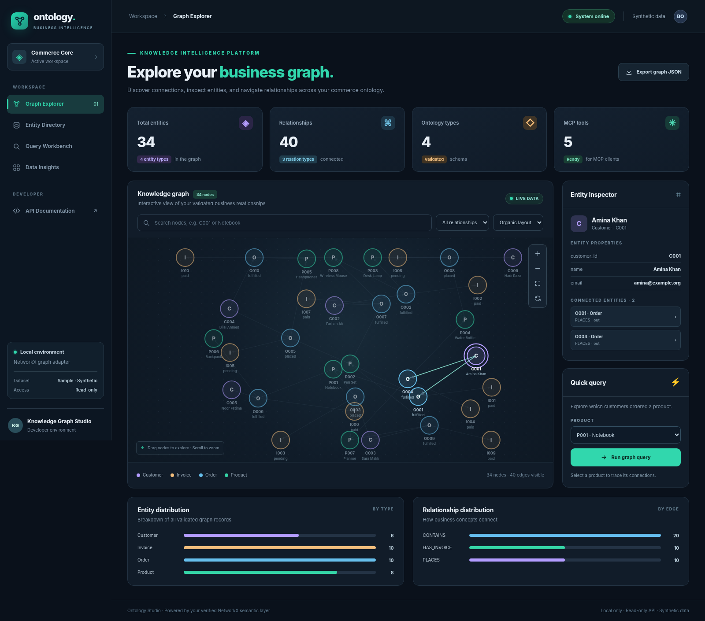
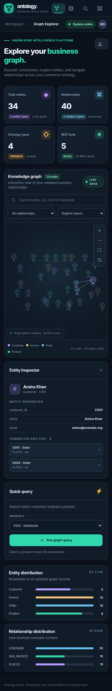

# Business Ontology Studio — Interactive frontend

## Purpose

A local browser dashboard for the existing `commerce_core` synthetic knowledge graph.
It uses the verified `SemanticService`, `NetworkXGraphAdapter`, ontology and CSV files.
It does **not** alter the Model Context Protocol (MCP) server, its tools or its stdio transport.

## Prerequisites

- Windows 10/11, Python 3.12 and the existing repository with `.venv` activated
- Existing project requirements and sample CSVs already installed/available
- `python -m pip install -r requirements-ui.txt`
- No Node.js / npm / React build is required for the web dashboard

## Start and stop

```powershell
# From business-ontology-mcp repository root with (.venv) activated:
python ui_server.py
# Open http://127.0.0.1:8000
# CTRL+C to stop
```

The UI serves on loopback (`127.0.0.1:8000`) only. If port 8000 is busy, edit
the `port=8000` value in `ui_server.py`, for example to `8008`.

Run backend tests separately:

```powershell
python -m pytest -v tests/test_ui_api.py
python -m pytest -q
```

## Pages and features

| Page | Features |
| --- | --- |
| Graph Explorer | Draggable SVG nodes, incoming/outgoing directed edges, mousewheel zoom, pan, layout, relationship filter, search, node inspector, JSON export |
| Entity Directory | Searchable table of all Customer, Product, Order, Invoice records; click through to the graph |
| Query Workbench | Execute the real `purchases_for_product` traversal and display customer, order and whole-invoice status/amount |
| Data Insights | Entity counts, relationship distribution, invoice-status counts, per-product order counts |
| API Documentation | FastAPI Swagger UI at `/docs` |

## API contract

| Method | Endpoint | Response |
| --- | --- | --- |
| GET | `/api/health` | Graph-loading status |
| GET | `/api/overview` | Entity, relationship, invoice-status counts and MCP tool names |
| GET | `/api/graph` | Typed nodes and directed edges generated from the real NetworkX graph |
| GET | `/api/ontology` | Existing ontology document |
| GET | `/api/entities?entity_type=Customer&q=...` | Search and filter entities |
| GET | `/api/entities/{type}/{id}` | Entity properties and bidirectional neighbors |
| GET | `/api/entities/{type}/{id}/related?direction=in&relation=PLACES` | Typed graph traversal |
| GET | `/api/queries/product-purchases?product_id=P001` | Grounded product purchase records |

Every API endpoint is read-only. Unknown entity IDs return HTTP 404.
Unknown types, relationships or directions return HTTP 400. Unsupported write methods return HTTP 405.

## Project structure added

```text
business-ontology-mcp/
├─ frontend/
│  ├─ index.html
│  ├─ styles.css
│  └─ app.js
├─ src/
│  └─ ui_app.py
├─ tests/
│  └─ test_ui_api.py
├─ ui_server.py
├─ requirements-ui.txt
└─ docs/ui-frontend-guide.md
```

## Live Loom demonstration (suggested 3–4 minutes)

1. Start `python ui_server.py` and open the dashboard. Explain the four entity types and three relationship types.
2. Drag a Customer node, zoom/pan, filter `PLACES`, select `C001` and show its O001 / O004 orders.
3. Switch to Entity Directory, find a customer by name and navigate back to the highlighted node.
4. Open Query Workbench, choose `P001`, execute; show three purchases and the pending invoice for O003.
5. Open Data Insights to show count breakdowns; use `/docs` to show HTTP endpoints.
6. In a second terminal, run `python -m pytest -q`, `python demo_mcp_client.py`, and `python -m scripts.inspector_smoke` to show independent MCP interoperability.

## Important limitations

- The dashboard visualizes only **synthetic** CSV data; it is not a live accounting/commerce system.
- An invoice amount belongs to an entire order, not an individual product.
- No login/roles are provided. Keep it bound to localhost; do not deploy it publicly as-is.
- The HTTP dashboard is an *additional interface*, not an autonomous LLM agent.
- Native Omnigraph CLI import remains unverified, independent of this NetworkX dashboard.
- Node positions are computed client-side; moving them does not change the underlying graph.

## Git workflow

Create a new feature branch. If the ONT-09 branch is not merged, base the new branch
on it and open a **stacked PR** against ONT-09; otherwise start from up-to-date `main`.

```powershell
git switch -c feature/ont-10-visual-dashboard
python -m pytest -q tests/test_ui_api.py
git add frontend/ src/ui_app.py ui_server.py requirements-ui.txt tests/test_ui_api.py docs/ui-frontend-guide.md
git diff --cached --check
git commit -m "ONT-10: Add interactive knowledge graph dashboard"
git push -u origin feature/ont-10-visual-dashboard
```

Create the PR on GitHub and merge after review.

## Screenshots

The package includes desktop and mobile previews generated against the reference
synthetic dataset. Your live localhost dashboard will show the actual local data.




